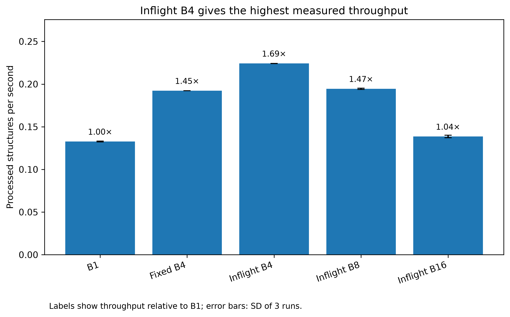
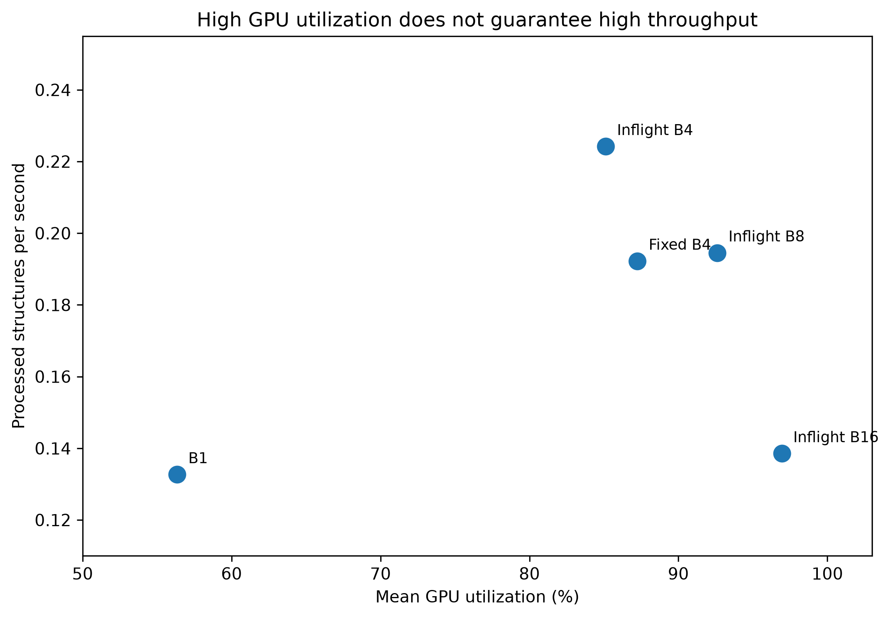

# ALCHEMI-UMA Catalysis

**GPU-accelerated catalyst relaxation with UMA and the NVIDIA ALCHEMI Toolkit.**

> **Status:** Internal research preview. The repository is private while the Swan source, data provenance, and convergence bookkeeping are reviewed. This is **not yet a complete, independently reproducible public release**.

## Research question

Can inflight GPU batching accelerate heterogeneous catalyst-relaxation workloads without substantially changing the behavior of individual-structure relaxation?

We benchmarked **500 OC20-Dense OOD validation structures (39,123 atoms)** using UMA `uma-s-1p2p1` with task `oc20` on a single NVIDIA L40S GPU.

## Main results

| Scheduling method | Runtime for 500 | Throughput (structures/s) | Mean GPU utilization |
|---|---:|---:|---:|
| B1 (one structure at a time) | 62.81 min | 0.1327 | 56.3% |
| Fixed B4 | 43.35 min | 0.1922 | 87.2% |
| **Inflight B4** | **37.17 min** | **0.2242** | **85.1%** |
| Inflight B8 | 42.84 min | 0.1945 | 92.6% |
| Inflight B16 | 60.16 min | 0.1385 | 96.9% |

- **1.69× B1 throughput**, or **40.8% less wall time**, with inflight B4 (three production replicates per method).
- **99.07%** matching B1/inflight convergence outcomes across **1,500** matched production comparisons.
- In a **separate, single-pass coordinate-capture experiment**, **181/183 (98.9%)** structures ending below the force threshold in both workflows agreed within **0.10 Å** mobile-atom RMSD.
- Higher GPU utilization did **not** necessarily translate into more completed structures per second.

### Visual summary

## Scientific interpretation

The production and coordinate-capture experiments used **different convergence-status bookkeeping**. Their raw convergence percentages must not be pooled or directly compared. Rare geometric outliers (notably samples 208 and 155) show that similar endpoint energies do not guarantee identical atomic configurations. This study does **not** establish DFT accuracy, universal batch-size optimality, or identical geometries for every system.

## Repository contents

- [`paper/MANUSCRIPT_V0_1.md`](paper/MANUSCRIPT_V0_1.md) — working research manuscript; **not submission-ready**
- [`docs/CLAIMS_AND_LIMITATIONS.md`](docs/CLAIMS_AND_LIMITATIONS.md) — what the experiments do and do not support
- [`results/phase5_publication/`](results/phase5_publication/) — 12 figures (PNG + SVG), derived tables and a Results draft
- [`results/production_500/analysis/`](results/production_500/analysis/) — production summaries and 1,500 paired comparisons
- [`scripts/05_benchmark_fixed.py`](scripts/05_benchmark_fixed.py) and [`scripts/06_benchmark_inflight.py`](scripts/06_benchmark_inflight.py) — Swan production benchmark implementations
- [`run_fixed_b01.sh`](run_fixed_b01.sh) and [`run_production_500.sh`](run_production_500.sh) — site-specific production SLURM launchers
- [`docs/SWAN_PRODUCTION.md`](docs/SWAN_PRODUCTION.md) — environment and execution provenance
- [`docs/VALIDATION_NOTES.md`](docs/VALIDATION_NOTES.md) — validation boundaries and unresolved discrepancy

## Reproducibility status

The source scripts and SLURM launchers transferred from Swan are now included. **They have not been independently rerun in a fresh environment.** The saved derived tables and 12 figures are also included. The original OC20-Dense LMDB, model checkpoint, and final `extxyz` coordinate files remain off GitHub pending redistribution review; regenerating the coordinate-based outlier figures therefore still requires those local files. The lightweight `pyproject.toml` is not a fully pinned GPU environment.

**Runtime context:** Python 3.12.14; PyTorch 2.13.0+cu130; CUDA 13.0; NVIDIA ALCHEMI 0.2.0; UMA `uma-s-1p2p1` with inference setting `default`; FIRE `fmax=0.05 eV/Å`, `max_steps=300`, `dt=0.1`.

No unpublished PFAS research data are included.

## Before making the repository public

1. Independently reproduce the workflow from a clean, pinned GPU environment.
2. Resolve the difference between production exit-state convergence and coordinate-capture post-hoc force-threshold labels.
3. Check source-data redistribution permissions and complete dataset provenance.
4. Review figures, references, dependencies, authorship and licensing before a public release.

This repository documents research in progress and does not imply peer review or publication.
