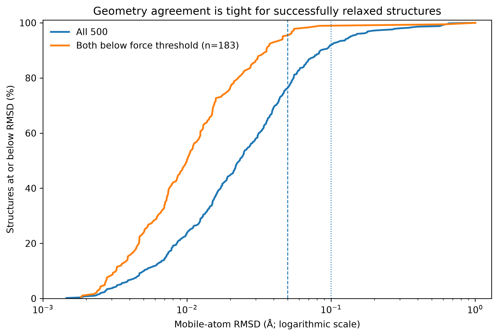

# ALCHEMI-UMA Catalysis — Phase 5 results

GPU-accelerated heterogeneous catalyst relaxation with the **NVIDIA ALCHEMI Toolkit** and the **UMA foundation interatomic potential**, evaluated on 500 public OC20-Dense OOD validation structures (39,123 atoms).

## At a glance

- **1.69× throughput vs B1** using inflight B4.
- **40.8% shorter runtime:** 62.81 → 37.17 minutes per 500 structures.
- **99.07% production convergence agreement** across 1,500 matched B1/inflight comparisons.
- **98.9% conditional geometry agreement within 0.1 Å** among 183 structures meeting the final-force threshold in both separate coordinate-capture runs.

**Core question:** Can inflight GPU scheduling improve throughput for a heterogeneous relaxation workload while retaining B1-like relaxation outcomes?

## Main figures




## Important interpretation

These are **two distinct experiments**: a three-replicate production benchmark for speed and convergence behavior, and a single-pass coordinate capture for final-geometry agreement. The geometry percentage is conditional on both endpoints passing the force threshold. Two successful-by-final-force structures (samples 208 and 155) have larger geometric differences, consistent with alternative adsorbate configurations. **We do not claim identical geometries, DFT accuracy, or a globally optimal batch size.**

## Navigate

- [Full Results and interpretation](docs/RESULTS.md)
- [Paper-style Results draft](paper/RESULTS_DRAFT.md)
- [Master performance table](tables/table1_master_results.csv)
- [Geometry threshold table](tables/table2_geometry_thresholds.csv)
- [Figure captions](docs/FIGURE_CAPTIONS.md)
- [Methods and reproduction](docs/METHODS_AND_REPRODUCIBILITY.md)

## Rebuild the package

Copy `scripts/10_build_phase5.py` into the benchmark project's `scripts/` folder, then run it from the project root:

```bash
python scripts/10_build_phase5.py
```

The builder reads the existing CSV and extxyz outputs. **No GPU job is required.** The original repository remains the source of the dataset manifest, numerical equivalence diagnostics, benchmarking scripts, and SLURM job configurations.